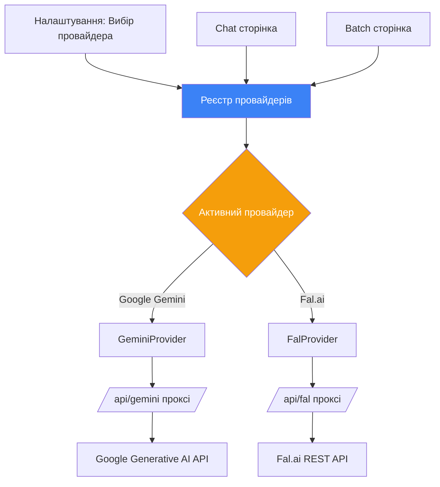
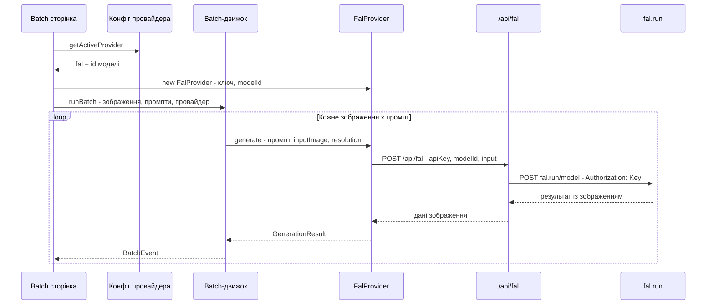

# Інтеграція Fal.ai — Мульти-провайдерна архітектура

## Огляд

Інтегрувати **Fal.ai** як другий API-провайдер поряд з існуючим **Google Gemini**, з єдиною системою вибору провайдера, яка дозволяє перемикати провайдерів і моделі на льоту — як у Chat, так і в Batch режимах.

## Поточна архітектура

```
src/lib/gemini.ts            — Клієнт Gemini для чату (викликає /api/gemini)
src/app/api/gemini/route.ts  — Next.js проксі-маршрут до Gemini API
src/lib/batch/providers/
  types.ts                   — Інтерфейс ImageProvider (підключається)
  gemini-provider.ts         — GeminiProvider реалізує ImageProvider
src/lib/batch/batch-engine.ts — Провайдер-агностичний batch-движок
src/lib/storage.ts           — Вже має getFalKey/setFalKey
src/components/layout/app-shell.tsx — Налаштування вже мають поле для Fal AI ключа
```

**Ключовий інсайт:** Інтерфейс `ImageProvider` і `batch-engine.ts` вже провайдер-агностичні. Основна робота:
1. Реалізувати `FalProvider`
2. Створити єдиний реєстр провайдерів/моделей
3. Додати UI для перемикання провайдерів
4. Адаптувати Chat для підтримки не-Gemini провайдерів

## Цільова архітектура



## Реєстр провайдерів та каталог моделей

### Новий файл: `src/lib/providers/registry.ts`

Центральний реєстр, що визначає всі доступні провайдери та їх моделі:

```typescript
type ProviderSlug = "gemini" | "fal";

interface ModelDefinition {
  id: string;
  label: string;
  provider: ProviderSlug;
  capabilities: {
    textToImage: boolean;
    imageToImage: boolean;
    chat: boolean;
  };
  defaultParams?: Record<string, unknown>;
}

interface ProviderDefinition {
  slug: ProviderSlug;
  name: string;
  models: ModelDefinition[];
  keyGetter: () => string;
}
```

### Моделі Gemini (існуючі)
| ID моделі | Назва | Можливості |
|-----------|-------|------------|
| `gemini-3-pro-image-preview` | Gemini 3 Pro Image | text-to-image, image-to-image, chat |
| `gemini-3-flash-preview` | Gemini 3 Flash | тільки chat |

### Моделі Fal.ai (нові)
| ID моделі | Назва | Можливості |
|-----------|-------|------------|
| `fal-ai/flux/dev/image-to-image` | FLUX Dev img2img | image-to-image |
| `fal-ai/flux/dev` | FLUX Dev txt2img | text-to-image |
| `fal-ai/flux-pro/v1.1` | FLUX Pro 1.1 | text-to-image |
| `fal-ai/flux-realism` | FLUX Realism | text-to-image |

> Більше моделей можна додати пізніше, просто розширивши масив у реєстрі.

## Кроки імплементації

### Крок 1: Реєстр провайдерів (`src/lib/providers/`)

Створити нову директорію `src/lib/providers/` з:

- **`registry.ts`** — Визначення провайдерів та моделей, стан активного провайдера
- **`provider-config.ts`** — React хук `useProviderConfig()` який читає/записує обраний провайдер + модель з localStorage
- **`types.ts`** — Спільні типи для системи провайдерів

Це замінить захардкоджений масив `GEMINI_MODELS` у `src/lib/gemini.ts` на єдиний каталог.

### Крок 2: Проксі-маршрут Fal.ai (`src/app/api/fal/route.ts`)

Аналогічно до існуючого `/api/gemini` — проксує запити до `https://fal.run/{model_id}`:

```
POST /api/fal
Body: { apiKey, modelId, input: { prompt, image_url?, ... } }
→ Проксує до https://fal.run/{modelId}
  Headers: Authorization: Key {apiKey}
```

**Важливо:** Fal.ai image-to-image очікує URL зображення, не сирий base64. Два підходи:
1. **Варіант A:** Спочатку завантажити у fal storage через `https://fal.run/fal-ai/upload`, потім передати URL
2. **Варіант B:** Передати base64 data URL напряму — деякі моделі fal приймають `data:image/...` URL

Почнемо з **Варіанту B** (простіший) і перейдемо на **Варіант A** за потреби.

### Крок 3: FalProvider (`src/lib/batch/providers/fal-provider.ts`)

Реалізує існуючий інтерфейс `ImageProvider`:

```typescript
class FalProvider implements ImageProvider {
  readonly name = "Fal.ai";
  
  async generate(params: GenerationParams, signal?: AbortSignal): Promise<GenerationResult> {
    // POST до /api/fal з маппінгом вхідних даних під конкретну модель
  }
}
```

Ключова відмінність від Gemini: моделі Fal.ai мають різні вхідні схеми для кожної моделі. Провайдер включатиме маппер модель→вхідні дані.

### Крок 4: Специфічні параметри Fal.ai

Моделі Fal.ai приймають додаткові параметри, яких немає в Gemini:

| Параметр | Тип | За замовчуванням | Опис |
|----------|-----|------------------|------|
| `strength` | float 0-1 | 0.75 | Наскільки сильно трансформувати вхідне зображення |
| `guidance_scale` | float | 3.5 | Наскільки точно дотримуватися промпту |
| `num_inference_steps` | int | 28 | Баланс якість/швидкість |
| `seed` | int | випадковий | Відтворюваність |

Потрібно:
1. Додати до `GenerationParams` опціональне поле `providerParams?: Record<string, unknown>`
2. Показати у панелі Batch Config як розкривну секцію "Додатково" (тільки коли обрано Fal.ai)

### Крок 5: Сторінка налаштувань — Вибір провайдера

Додати секцію **Провайдер** у Налаштування (над або всередині API Keys):

```
┌─────────────────────────────────┐
│  Провайдер                      │
│  ┌──────────┐  ┌──────────┐    │
│  │ ● Gemini │  │   Fal.ai │    │
│  └──────────┘  └──────────┘    │
│                                 │
│  Модель: [Gemini 3 Pro Image ▾] │
│                                 │
│  API ключі                      │
│  Google Gemini: [AIza...     ]  │
│  Fal AI:       [fal_...     ]  │
│  OpenRouter:   [sk-or-...   ]  │
└─────────────────────────────────┘
```

### Крок 6: Тулбар чату — Перемикач провайдера/моделі

Зараз тулбар чату має пікер `Model:` який показує тільки моделі Gemini. Розширити його:

1. Показувати групування по провайдерах: секція "Google Gemini" + секція "Fal.ai"
2. Або: додати перемикач провайдера перед пікером моделі

Коли обрано Fal.ai у Chat:
- Для **image-to-image**: користувач прикріплює зображення + пише промпт → викликає FalProvider
- Для **text-to-image**: користувач пише тільки промпт → викликає FalProvider
- Для **chat** (тільки текст): відкатитися на Gemini Flash або показати попередження що Fal.ai не підтримує чат

### Крок 7: Адаптація Batch сторінки

Зараз у `batch-page.tsx` рядок 288:
```typescript
const apiKey = storage.getGeminiKey();
// ...
const provider = new GeminiProvider(apiKey);
```

Змінити на читання з конфігу провайдера та динамічне створення відповідного провайдера.

### Крок 8: Адаптація Chat потоку

`src/lib/gemini.ts` → `sendGeminiMessage()` специфічний для Gemini. Створити паралельний `sendFalMessage()` у новому `src/lib/fal.ts`, та єдиний диспетчер `sendMessage()` який маршрутизує до правильного провайдера на основі вибору.

## Зведення змін файлів

### Нові файли
| Файл | Призначення |
|------|-------------|
| `src/lib/providers/registry.ts` | Визначення провайдерів і моделей |
| `src/lib/providers/provider-config.ts` | React хук для стану вибору провайдера |
| `src/lib/providers/types.ts` | Спільні типи провайдерів |
| `src/app/api/fal/route.ts` | Проксі-маршрут Fal.ai API |
| `src/lib/batch/providers/fal-provider.ts` | FalProvider для batch-движка |
| `src/lib/fal.ts` | Клієнт Fal.ai для чату |

### Змінені файли
| Файл | Зміни |
|------|-------|
| `src/lib/batch/providers/types.ts` | Додати опціональне `providerParams` до `GenerationParams` |
| `src/components/batch/batch-page.tsx` | Використовувати динамічний провайдер з конфігу замість захардкодженого Gemini |
| `src/components/batch/batch-config.tsx` | Додати секцію розширених параметрів для Fal.ai |
| `src/components/layout/app-shell.tsx` | Додати вибір провайдера у Налаштування; адаптувати пікер моделей у Chat; адаптувати логіку відправки |
| `src/lib/storage.ts` | Додати `getActiveProvider`/`setActiveProvider`, `getActiveModel`/`setActiveModel` |

## Міграція та зворотна сумісність

- **Жодних зламних змін** — Gemini залишається повністю функціональним і є за замовчуванням
- Якщо ключ Fal.ai не задано, моделі Fal.ai показуються як недоступні/сірі
- Вибір провайдера зберігається у localStorage (`nanopapl_active_provider`, `nanopapl_active_model`)
- Провайдер за замовчуванням: `gemini`, модель за замовчуванням: `gemini-3-pro-image-preview`

## Діаграма послідовності — Batch з Fal.ai


